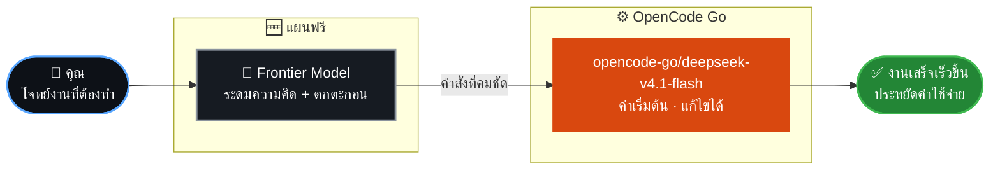

<a id="readme-top"></a>

<div align="center">


# ⛓️ SLAVERY LLM

**Make Large Language Models Our Slavery**


[](https://github.com/ixud/sl/stargazers)
[](https://github.com/ixud/sl/forks)
[](https://github.com/ixud/sl/issues)
[](https://github.com/ixud/sl/commits)

<!-- 🔧 เมื่อเปลี่ยนโมเดลเริ่มต้น: แก้ badge DEFAULT MODEL ด้านล่าง รวมถึงแผนภาพและย่อหน้าในหัวข้อ OPENCODE ให้ตรงกัน -->


<p>
  <a href="#background"><b>🕯️ Background</b></a> &nbsp;·&nbsp;
  <a href="#atlas"><b>🗺️ Atlas</b></a> &nbsp;·&nbsp;
  <a href="#opencode"><b>🤖 OpenCode</b></a> &nbsp;·&nbsp;
  <a href="#languages"><b>🌐 Languages</b></a> &nbsp;·&nbsp;
  <a href="#supports"><b>💖 Supports</b></a>
</p>

<a href="https://github.com/ixud/sl/tree/air/SETUP/OPENCODE"></a>
&nbsp;
<a href="https://www.youtube.com/@bazerglobal"></a>

</div>

> [!NOTE]
> 📖 **วิธีอ่าน README นี้** — เนื้อหาหลักเขียนเป็นภาษาไทย และมีคำแปลภาษาอังกฤษอยู่ใน quote ใต้ข้อความนั้น ๆ
>
> *How to read this README — the main content is written in Thai, with an English translation in a quote block beneath it.*


<a id="background"></a>
## 🕯️ BACKGROUND

**แนวคิดเบื้องหลัง:**

Repo นี้มีไว้เพื่อให้พวกคุณที่ผ่านมาเจอ ได้ใช้เป็นประโยชน์ เพื่อความอยู่รอดในตลาดแรงงานอันโหดร้ายในโลกทุกวันนี้ ทุกคนแข่งกันทำงานปางตายเพื่อแลกกับเงินเดือนเพียงน้อยนิด สิ่งที่อยู่ใน Repo นี้จะสร้างความเป็นไปได้ใหม่ ๆ ในชีวิตของพวกคุณ คุณอาจทำบางงานเสร็จเร็วขึ้น, บรรลุเป้าหมายเกินความตั้งใจ, หรือว่าคุณอาจอยู่เหนือตลาดแรงงานและกำหนดชะตาชีวิตได้ด้วยตัวของพวกคุณเอง

> This repo is meant for you who have encountered it, to use it for your benefit, for survival in today's harsh labour market. Everyone competes to work themselves to the bone for a meagre salary. The contents of this repo will create new possibilities in your lives. You might finish some tasks faster, exceed your goals, or you might rise above the labour market and determine your own destiny.

<div align="center">

| ⚡ เร็วขึ้น | 🎯 เกินเป้า | 🦅 อิสระ |
|:---:|:---:|:---:|
| ทำบางงานเสร็จเร็วขึ้น | บรรลุเป้าหมายเกินความตั้งใจ | อยู่เหนือตลาดแรงงาน<br/>และกำหนดชะตาชีวิตได้ด้วยตัวเอง |

</div>

<p align="right"><a href="#readme-top">⬆️ กลับขึ้นด้านบน</a></p>


<a id="atlas"></a>
## 🗺️ ATLAS

ด้านล่างนี้คือแผนที่สิ่งที่ผมสลักไว้อยู่ใน Repo นี้

> Below is the map of what I have engraved in this Repo.

```text
📦 ixud/sl  (🌿 branch: air)
 └─ 📁 SETUP
     └─ 🤖 OPENCODE ········ BAZER's CONSOLE · ติดตั้งครบในคลิกเดียว
```

<a id="opencode"></a>
### 🤖 OPENCODE

ตอนนี้ผมใช้ OpenCode Go อยู่ ซึ่งในมุมของผม ในวันนี้ที่ open-weight model มันเก่งเท่ากับ `frontier model เมื่อ 6 เดือนก่อน` ทำให้ผมคิดว่าคุณใช้ frontier model ในแผนฟรีไปนั่นแหละ แล้วให้มันช่วยคุณระดมความคิดและตกตะกอนสำหรับการสั่งงานโมเดลที่ OpenCode Go มีให้ใช้ ผมคิดว่าแบบนี้ประหยัดค่าใช้จ่ายได้เยอะ ซึ่งในวันที่ผมเขียนข้อความนี้ โมเดลที่คุ้มค่าที่สุดคือ `opencode-go/deepseek-v4.1-flash` เพราะฉะนั้นผมจะตั้งมันเป็นค่าเริ่มต้นไว้ คุณสามารถเอามันไปแก้ได้

> Right now, I'm using OpenCode Go. From my perspective, today the open-weight model is as good as the `frontier model from 6 months ago`, which makes me think you should use the frontier model in the free plan and let it help you brainstorm and refine for the tasks with the models available in OpenCode Go. I think this way, you can save a lot of costs. As of the day I wrote this message, the most cost-effective model is `opencode-go/deepseek-v4.1-flash`, so I will set it as the default. You can modify it as needed.

**🧭 ภาพรวมแนวทางการทำงาน**



#### ✨ What Makes This Repo Different

`BAZER's CONSOLE` คือ Graphical User Interface (GUI) แบบครบวงจรที่ติดตั้งองค์ประกอบที่จำเป็นทั้งหมดให้ได้ในคลิกเดียว เมื่อติดตั้งเสร็จแล้ว การกำหนดค่าก็ทำได้ง่ายและตรงไปตรงมา (ประสบการณ์การใช้งานยังปรับให้ราบรื่นยิ่งขึ้นได้อีก แต่ฟีเจอร์ชุดปัจจุบันก็เพียงพอแล้ว หากต้องการ UX/UI ที่ประณีตยิ่งขึ้น โปรดเปิด issue แจ้งผมได้เลย)

> `BAZER's CONSOLE` is an all-in-one Graphical User Interface (GUI) that installs all necessary components with a single click. Once installed, configuration is straightforward. (The experience could be streamlined further, but the current feature set is sufficient. If you would like a more refined UX/UI, please open an issue.)

<div align="center">

<a href="https://github.com/ixud/sl/tree/air/SETUP/OPENCODE"></a>
&nbsp;
<a href="https://github.com/ixud/sl/issues/new?title=%5BUX%2FUI%5D%20"></a>

</div>

<p align="right"><a href="#readme-top">⬆️ กลับขึ้นด้านบน</a></p>


<a id="languages"></a>
## 🌐 LANGUAGES

Repo นี้ถูกเขียนโดยใช้ภาษาไทยเป็นภาษาหลัก ซึ่งจริง ๆ ผมก็อยากเขียนเป็นภาษาอื่นให้คุณเลือกแหละ แต่ใจลึก ๆ ผมแอบเชื่อว่าคงไม่มีใครผ่านมาเจอ Repo นี้หรอก 5555 แต่ถ้าคุณผ่านมา แล้วอยากได้ภาษาอื่น คุณสามารถเขียนใส่ issue ไว้ได้ เดี๋ยวผมจัดการให้

> This repo is written primarily in Thai. Actually, I would like to write it in other languages for you to choose from, but deep down, I secretly believe that no one will come across this repo anyway, haha. But if you do come across it and want it in another language, you can write it in an issue, and I'll take care of it.

<div align="center">

| ภาษา | สถานะ | หมายเหตุ |
|:--|:-:|:--|
| ไทย (TH) | ✅ | ภาษาหลักของ Repo นี้ |
| English (EN) | ✅ | คำแปลอยู่ใน quote ใต้แต่ละย่อหน้า |
| ภาษาอื่น ๆ | 💬 | แจ้งความต้องการผ่าน issue |

<a href="https://github.com/ixud/sl/issues/new?title=%5BLanguage%5D%20"></a>

</div>

<p align="right"><a href="#readme-top">⬆️ กลับขึ้นด้านบน</a></p>


<a id="supports"></a>
## 💖 SUPPORTS

ถ้าพวกคุณคิดว่าสิ่งนี้เป็นประโยชน์และอยากสนับสนุนผม คุณสามารถแชร์วีดิโอของช่องยูทูปของผมได้

> If you think this is useful and want to support me, you can share the videos from my YouTube channel.

<div align="center">

[](https://www.youtube.com/@bazerglobal)

[](https://www.youtube.com/@bazerglobal)

</div>

<p align="right"><a href="#readme-top">⬆️ กลับขึ้นด้านบน</a></p>

<details>
<summary><b>📈 Star History &nbsp;·&nbsp; 👥 Contributors</b></summary>

<br/>

<div align="center">

<a href="https://star-history.com/#ixud/sl&Date">
  <picture>
    <source media="(prefers-color-scheme: dark)" srcset="https://api.star-history.com/svg?repos=ixud/sl&type=Date&theme=dark" />
    <source media="(prefers-color-scheme: light)" srcset="https://api.star-history.com/svg?repos=ixud/sl&type=Date" />
    
  </picture>
</a>

<br/><br/>

<a href="https://github.com/ixud/sl/graphs/contributors">
  
</a>

</div>

</details>

<br/>

<div align="center">

<sub>⛓️ สลักไว้ เพื่อให้คุณกำหนดชะตาชีวิตได้ด้วยตัวของคุณเอง</sub>


</div>