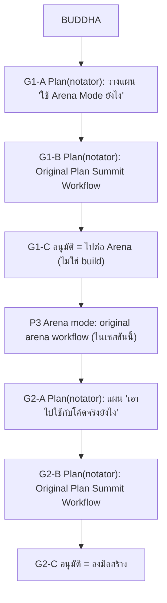

# BAZER FLOW — แผนที่ dependency และสเปคโฟลว์ (v1)

ไฟล์นี้อธิบายว่า "อะไรคุมอะไร" ตั้งแต่ git → BAZER Console → ไฟล์ในเครื่อง → OpenCode และระบุโฟลว์บังคับของ BUDDHA MODE ที่ทุกเครื่องต้องได้เหมือนกัน

อ่านคู่กับ: `README.md` (เจตนาของแต่ละโหมด) · `GUIDE.md` (ตำแหน่งไฟล์ทั้งหมดของ OpenCode)


## 0) อ่านที่เดียว — ไฟล์นี้เป็นเจ้าของความจริงเรื่องโฟลว์

ไฟล์นี้เป็น **ต้นทางเดียว** ของ 5 เรื่องนี้ ถ้าเอกสารอื่นเขียนต่างจากที่นี่ ให้ถือว่าที่นี่ถูก

| เรื่อง | อยู่ส่วนไหน |
|---|---|
| ต้นทาง → ปลายทางของทุกชั้นไฟล์ | §1 |
| ปุ่มใน Console ทำอะไร / ไม่ทำอะไร | §2 |
| BAZER FLOW v1 (7 เฟส) + กติกา marker | §3 |
| ลำดับหลัง `git pull` (push ก่อน แล้วค่อย pull) | §4 |
| ตัวตรวจที่ต้องเขียว | §5 |

เอกสารอื่น **ห้ามคัดลอกตารางใน §1 และ §2** ให้เขียนเป็นตัวชี้ เช่น "ดูตารางต้นทาง → ปลายทางที่ `FLOW.md` §1" (สรุปสั้น ๆ ที่ผู้ใช้อ่านได้ เช่น ลำดับ 7 เฟสใน GUIDE ให้ย่อและต้องไม่ขัดกับ §3)

**config root อาจเป็น junction:** `%USERPROFILE%\.config\opencode` อาจเป็น **junction** ไปโฟลเดอร์อื่น (เครื่องนี้ชี้ไป `%USERPROFILE%\.config\opencode-profiles\default`) — เป็นโฟลเดอร์เดียวกันจริง ไม่ใช่สำเนา (ไฟล์ ID ข้างในตรงกัน · reparse tag `0xa0000003`) Console แสดง path ปลายทางจริงในแท็บภาพรวม · ถ้าต้องการย้าย config ให้ย้ายที่ "ตัวปลายทาง" ไม่ใช่ที่ตัวลิงก์

**นโยบาย template (`AGENTS.md` · `pstack-models.md`):** สองไฟล์นี้ถูกสร้าง **ครั้งเดียว** จาก `CONSOLE/bundle/config/*.template` ตอนติดตั้ง และ **ไม่ถูกทับ** ตอนอัพเดต — ถ้า bundle แก้ template ไฟล์ในเครื่องจะยังเป็นของเดิมจนกว่าจะกด "รีเซ็ตจาก template" · ตัวตรวจเทียบ **เนื้อหา** ระหว่างไฟล์ในเครื่องกับ template (ไม่ใช้ marker) — `ok` = ตรง · `info` = ถูกแก้เอง (ระบบไม่ทับให้เอง ตั้งใจ) · `warn` = ยังไม่มี หรือ bundle ใหม่กว่า


## 1) เส้นทางไฟล์ (ต้นทางเดียว → ปลายทางจริง)

ต้นทางเดียวคือ repo นี้ (`SETUP/OPENCODE/CONSOLE/bundle/`) ส่วนปลายทางคือโฟลเดอร์ที่ OpenCode อ่านจริงในเครื่องผู้ใช้

| ชั้น | ต้นทาง (repo) | ปลายทาง (เครื่อง) | ตัวเขียน |
|---|---|---|---|
| agents | `CONSOLE/bundle/agents/*.md` | `%USERPROFILE%\.config\opencode\agents\` | `setup-apply` (เฉพาะไฟล์ใหม่) · `update-apply` (ทับเมื่อต่าง) |
| commands | `CONSOLE/bundle/commands/*.md` | `%USERPROFILE%\.config\opencode\commands\` | เหมือน agents |
| skills | `CONSOLE/bundle/skills/**` | `%USERPROFILE%\.agents\skills\` | เหมือน agents |
| mirrors | generate จาก agent ที่ติดตั้งแล้ว (ถ้าไม่มี ใช้ bundle) | `%USERPROFILE%\.agents\skills\BAZERs-EXTENSION-*\SKILL.md` | `mirror-agents` (Console แท็บ Buddha) |
| config | สร้างในตัวแอป (ไม่อยู่ใน bundle) | `%USERPROFILE%\.config\opencode\opencode.jsonc` | `plannotator-toggle` · `setup-apply` · `refresh-config` |
| template | `CONSOLE/bundle/config/AGENTS.md.template` | `%USERPROFILE%\.config\opencode\AGENTS.md` | สร้างครั้งเดียว (ถ้าไม่มี) · `reset-template` เมื่อสั่ง |
| template | `CONSOLE/bundle/config/pstack-models.template.md` | `%USERPROFILE%\.agents\pstack-models.md` | สร้างครั้งเดียว (ถ้าไม่มี) · `reset-template` เมื่อสั่ง |
| plugins | `CONSOLE/bundle/plugins/bazer-fire/**` | `%USERPROFILE%\.config\opencode\plugins\bazer-fire\` | `setup-apply` (ทับเสมอ) |
| launch | `CONSOLE/launch-template/**` | `%USERPROFILE%\opencode-launch\` | `setup-apply` (ไม่ทับไฟล์ที่มี) |

ถูก gitignore (ค่าเฉพาะเครื่อง ไม่ขึ้น git): `CONSOLE/console.config.json`, `CONSOLE/console.runtime.json`, `CONSOLE/history.tsv`, `CONSOLE/backups/`


## 2) ใครคุมอะไร (Console)

| การกด | ทำอะไร | ไม่ทำอะไร |
|---|---|---|
| **ติดตั้งเสร็จสรรพ - ทั้งหมด** (แท็บภาพรวม) | สร้างโฟลเดอร์ + ลงทะเบียน Plannotator + คัดลอก skills/agents/commands **เฉพาะไฟล์ที่ยังไม่มี** + สร้าง AGENTS.md/pstack-models จาก template + ติดตั้ง bazer-fire + ไฟล์ launch + อัพเดต mirror | **ไม่ทับไฟล์ที่มีอยู่** (โหมดที่แก้ไว้จะไม่ถูกอัพเดต) |
| **ตรวจว่ามีอะไรใหม่ + อัพเดตทั้งหมด** (แท็บภาพรวม) | เทียบ bundle กับเครื่อง แล้วทับเฉพาะที่ต่าง/ใหม่: skills · agents · commands · plugins · launch (พร้อมสำรอง) แล้วรัน mirror ให้อัตโนมัติ + รีเฟรช `planningAgents` ถ้าขาด | ไม่ทับ AGENTS.md · pstack-models.md · serve-restricted.jsonc (ต้องใช้ปุ่มรีเซ็ตถ้าต้องการ) |
| **อัพเดต mirror ทั้งหมด** (แท็บ Buddha) | เขียน `BAZERs-EXTENSION-*` จาก agent ที่ติดตั้งไว้ (fallback bundle) | ไม่แตะ agent/สกิลอื่น |
| **🔄 ซิงค์ทั้งหมด** (แท็บภาพรวม) | รัน `update-apply` → `refresh-config` → `mirror-agents` แล้วรัน verify ให้ในคลิกเดียว | ไม่ทับ AGENTS.md · pstack-models.md (เหมือน "อัพเดตทั้งหมด") · ไม่แตะ serve-restricted.jsonc |
| **เปิด/ปิดปลั๊กอิน Plannotator** (แท็บ Plannotator) | เขียน `plugins` + `planningAgents` ใน `opencode.jsonc` | ไม่แตะไฟล์อื่น |

**แก้โหมด:** แก้ที่ `CONSOLE/bundle/agents/*.md` เท่านั้น แล้วกดอัพเดต — ห้ามแก้ `~/.agents/skills/BAZERs-EXTENSION-*/SKILL.md` ตรง ๆ เพราะไฟล์นั้นถูก generate และจะถูกทับ


## 3) BAZER FLOW v1 (บังคับ)

BUDDHA MODE เดินเป็นเครื่องสถานะ 7 เฟสในเซสชันเดียว ไม่สลับ agent และไม่เข้า build ระหว่างทาง



| เฟส | ต้องทำ | ทางออก |
|---|---|---|
| **G1-A** | โจทย์ · candidates 2-3 ทางที่ต่างเชิงโครงสร้าง · rubric · ข้อจำกัด (ห้ามแตะโปรเจกต์) | ยื่นด่าน 1 |
| **G1-B** | แผนฉบับเต็มตาม workflow เดิมของ Plannotator | รวมในด่าน 1 เดียวกัน |
| **G1-C** | อนุมัติ ("Approve and Build") = ไปต่อเฟส Arena **ไม่สลับ agent ไม่เข้า build** | |
| **P3** | โหลด `BAZERs-EXTENSION-Arena` รันในเซสชันนี้: Fan out → Cross-judge → Pick a base → Graft → Verify (candidates ลง temp) | |
| **G2-A** | base ที่เลือก + เหตุผล · grafts · ไฟล์/จุดที่แตะ · ความเสี่ยง · วิธีพิสูจน์ | ยื่นด่าน 2 |
| **G2-B** | แผน implementation ฉบับเดียว | รวมในด่าน 2 |
| **G2-C** | อนุมัติ = ลงมือสร้าง (ในเซสชันนี้ หรือผู้ใช้สลับเป็น build เอง) | |

กติกาเด็ดขาด

- ห้ามยื่นด่าน 2 ก่อน P3 จบ (ต้องมีผล Arena ประกอบ)
- ห้ามแตะไฟล์โปรเจกต์ก่อน G2-C ยกเว้นไฟล์ชั่วคราวใน `%TEMP%\bazer\<slug>\`
- หลังอนุมัติแต่ละด่าน ห้ามสลับ agent เอง ให้เดินเฟสถัดไปในเซสชันนี้ (ถ้าผู้ใช้เลือกสลับเองในหน้าอนุมัติ ให้ทำตาม `arena.md` ในเซสชันนั้น)
- ถ้าผู้ใช้สั่ง "ข้าม arena" ให้ยื่นแผนเดียวจบที่ด่าน 1 แล้วไป G2-C
- **ยื่นด่าน 2:** ใช้ `submit_plan` ถ้ายังมีในเซสชัน · ถ้าไม่มีแล้ว (ออกจาก plan mode หลังอนุมัติด่าน 1) ให้ยื่นด้วย Plannotator CLI `plannotator annotate <ไฟล์แผน.md> --gate --json --require-approval --result-file <ไฟล์ผล.json>` — ต้องได้อนุมัติก่อนสร้างเสมอ (ห้ามตีความว่า "ไม่มีปุ่ม = ข้ามด่านได้")
- ตัวตรวจ: marker `<!-- BAZER-FLOW: v1 -->` ต้องปรากฏใน `bundle/agents/buddha.md` และใน mirror ของ Buddha — marker อยู่ใน **เนื้อหา** ของ `bundle/agents/buddha.md` เอง (ไม่ใช่ตัวเติมอัตโนมัติ) mirror จึงได้ไปพร้อมเนื้อหาที่ copy มา และตัวตรวจในแอปเทียบ **เลขเวอร์ชัน** ระหว่าง bundle กับไฟล์ที่ติดตั้งในเครื่อง (ตรงกัน = ป้ายเขียว `BAZER FLOW v1` ในแท็บ Buddha)


## 4) git — push ก่อน แล้วค่อย pull ที่เครื่องอื่น

**ต้นทางเดียวคือ repo นี้** งานที่ยังไม่ push จะไม่ถึงเครื่องอื่นเลย — เช็คก่อนเสมอว่ากด push แล้วหรือยัง (บรรทัด `git status -sb` จะบอกว่าอยู่ branch ไหน และนำหน้า/ตามหลัง remote กี่ commit)

```powershell
git -C "<โฟลเดอร์ repo>" status -sb      # ดูว่าอยู่ branch ไหน และนำหน้า/ตามหลัง remote กี่ commit
git -C "<โฟลเดอร์ repo>" push            # branch air ผูกกับ fire/air อยู่แล้ว
```

หลัง `git pull` (ที่เครื่องอื่น หรือเครื่องเดิมหลังดึงของใหม่) ทำ 5 ขั้นนี้:

1. ปิด-เปิด BAZER Console ใหม่ (ตัวแอปอ่านโค้ดครั้งเดียวตอนเปิด)
2. แท็บภาพรวม กด **ตรวจว่ามีอะไรใหม่** แล้ว **อัพเดตทั้งหมด** — หรือกด **🔄 ซิงค์ทั้งหมด** ปุ่มเดียวจบ (อัพเดต + planningAgents + mirror)
3. กด **อัพเดต mirror ทั้งหมด** ในแท็บ Buddha (ถ้าขั้นตอนที่ 2 ทำให้แล้ว จะขึ้นว่าตรงครบ)
4. กด **⚡ ตรวจความครบ** แล้วต้องเขียวทุกข้อ
5. ปิด-เปิด OpenCode (session ใหม่จึงได้ config/agent/สกิลใหม่)


## 5) ตัวตรวจที่ควรเขียว (Verify)

- ไฟล์ config อ่านได้ทั้งหมด
- agent ทุกตัว frontmatter ผ่าน (color เป็น hex)
- `planningAgents` ครอบโหมดจริง: `buddha`, `arena`, `snack`, `poteto-mode` (บวก `plan` ของตัว OpenCode)
- mirror โหมด `BAZERs-EXTENSION-*` ตรงกับต้นทางทุกตัว
- BAZER FLOW v1: marker ตรงกันระหว่าง bundle กับไฟล์ที่ติดตั้ง
- ไฟล์ launch ครบ (serve + lock scripts) — ข้อความต้องบอก **โฟลเดอร์ที่ตรวจ** (ค่าเริ่มต้น `%USERPROFILE%\opencode-launch` เมื่อ `launchDir` ว่าง) เพื่อให้รู้ว่าต้องกดปุ่มไหนต่อ
- template ส่วนตัว (`AGENTS.md` · `pstack-models.md`): ต้องเป็น `ok` (ตรงกับ bundle) หรือ `info` (ถูกแก้เอง — ระบบไม่ทับให้เอง ตั้งใจ) ห้ามเป็น `warn` ว่า "ยังไม่มี"
- หมายเหตุ: "มีไฟล์" ไม่เท่ากับ "ตรงกับ bundle" — สองไฟล์นี้ถูกสร้างครั้งเดียว การอัพเดต `bundle/config/*.template` จึงไม่ถึงไฟล์ในเครื่องจนกว่าจะกด "รีเซ็ตจาก template" ตัวตรวจนี้คือที่เดียวที่ทำให้เรื่องนี้มองเห็นได้
