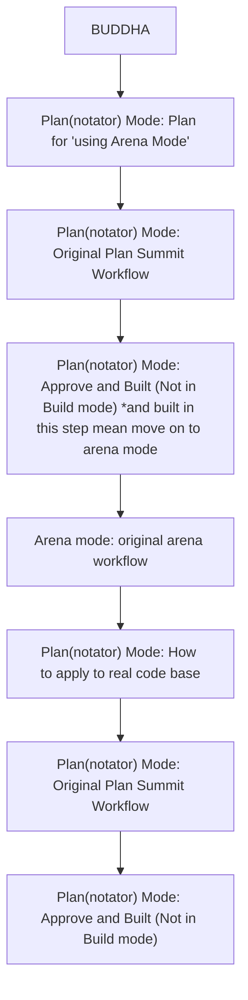

# COVERING

ผมได้สอนวิธีการใช้แบบ Non-code User ไว้ใน GUIDE.md
ซึ่งรวมท่าแปลก ท่ายากอะไรไป
ถ้าคุณคิดว่ามันมากไป ก็ไม่ต้องอ่านก็ได้
สิ่งที่อยู่ใน BAZER Console (โฟลเดอร์ CONSOLE) สามารถช่วยคุณได้

I have taught how to use it as a Non-code User in GUIDE.md.
Which includes strange and difficult poses.
If you think it's too much, you don't have to read it.
BAZER Console (the CONSOLE folder) can help you.

**โฟลเดอร์ในชุดนี้ / Folders in this pack:**

- `CONSOLE/` — **BAZER Console** — ดับเบิลคลิก `BAZER Console.vbs` ตัวเดียวจบ: ติดตั้งทุกอย่างในคลิกเดียวจาก bundle ที่แนบมา (config, skills ~54, agents, commands, ปลั๊กอิน Plannotator + bazer-fire 🔥)
- ไฟล์โหมดทั้งหมด (agents + skills + ปลั๊กอิน bazer-fire) อยู่ใน `CONSOLE/bundle` เป็นแหล่งเดียว — แก้ที่ bundle แล้วเปิด BAZER Console → แท็บภาพรวม → "อัพเดตทั้งหมด" เพื่อลงเครื่อง
- `GUIDE.md` — คู่มือฉบับ non-code: ไฟล์ตั้งค่าคืออะไร อยู่ตรงไหน ทำไมต้องมี (อ่านเมื่ออยากเข้าใจเบื้องหลัง)

- `CONSOLE/` — **BAZER Console** — double-click `BAZER Console.vbs`: one click installs everything from the attached bundle (config, ~54 skills, agents, commands, Plannotator + bazer-fire plugins)
- All mode files (agents, skills, the bazer-fire plugin) live in `CONSOLE/bundle` as the single source — edit there, then press update in BAZER Console (Overview tab) to install
- `GUIDE.md` — the non-code guide: what the config files are, where they live, and why

|  | Max Efficiency on Max Effort | No Loops Think, No Unnecessary Think | EXTREMELY OBVIOUS FILE/FOLDER PATH | Read that PATH content | Edit that PATH content |
| --- | --- | --- | --- | --- | --- |
| BAZER | ✅ | ✅ | ✅ | ✅ | ✅ |
| SNACK | ✅ | ✅ | ✅ | ✅ | ❌ |
| ADVISOR | ✅ | ✅ | ❌ | ❌ | ❌ |

# TOOLS

ผมยกย่องและให้เครดิตสองสิ่งนี้มาก

I highly admire and credit these two:

## PLANNOTATOR

ใน Terminal Command ที่เขาให้มาในเว็บของเขา อาจจะไม่ได้พร้อมใช้งานขนาดนั้น คุณต้องเชื่อมต่อนิดหน่อยเข้ากับ OPENCODE เอง ซึ่ง, อีกครั้ง, BAZER Console สามารถช่วยชีวิตคุณได้

In the Terminal Command he provided on his website, it might not be fully functional. You need to connect a bit with OPENCODE itself, which, once again, BAZER Console can save your life.

Features ที่มีมันล้ำจนอธิบายได้ยากว่ามันทำอะไรได้บ้าง ถ้าเปรียบ plan mode เหมือนรถจักรยาน PLANNOTATOR คือเครื่องบิน Hypersonic ของทหารเลยก็ว่าได้ คุณต้องลองเอง แล้วทุก ๆ วันคุณจะพบ use cases ที่น่าตื่นเต้นทุกวัน มันจะทำให้คุณทำงานได้สุดยอดมากขึ้นในทุก ๆ วัน คุณลองออกแบบ workflow ของตัวเองก็ได้

The features are so advanced that it's hard to explain what they can do. If you compare the plan mode to a bicycle, PLANNOTATOR is like a military hypersonic jet. You have to try it yourself, and every day you'll discover exciting use cases. It will make you work exceptionally well every day. You can even design your own workflow.

สิ่งที่ฝังมาใน Plan Mode ที่คุณสามารถตั้งค่าได้จาก BAZER Console ดังกล่าว

The things embedded in Plan Mode that you can configure from the aforementioned BAZER Console. 

## PSTACK

เป็นของ Poteto (Lauren Tan) วิศวกรชาวไทยที่มีความอัจฉริยะและรังสรรค์สิ่งนี้ขึ้นมา

It belongs to Poteto (Lauren Tan), a Thai engineer who is brilliant and crafted this. 

ในนี้มีสองสิ่งใหญ่ ๆ

In here, there are two main stuffs:

1. ชุด Skills จำนวนมหาศาล ที่เขียนใส่ markdown file เหมือนกับที่คุณกำลังอ่านนี้แหละ มันทำหน้าที่เหมือน AGENT.md ที่จะคอยกำหนดให้ LLM ประพฤติในทิศทางที่คุณต้องการ แต่ว่าของ PSTACK คือเวอร์ชันแบบมหึมา เป็น Rule Base ที่จะช่วยให้ LLM ทำในสิ่งที่คุณจะวางใจกับมันได้

สิ่งที่อยู่ใน Poteto Mode ที่คุณสามารถ install ได้จาก BAZER Console

1. A massive set of Skills written in a markdown file, just like the one you are reading now. It functions like AGENT.md, guiding the LLM to behave in the direction you want. However, PSTACK is the colossal version, a Rule Base that ensures the LLM does what you can trust it to do.

Things in Poteto Mode that you can install from BAZER Console

2. Arena Mode ซึ่งสิ่งนี้คือพระเจ้า ที่จะทำให้ผลลัพธ์ของคุณยิ่งไว้ใจได้เหมือนกับที่ Poteto เขาตั้งใจไว้ มันคือการทำให้ Model เล็ก ๆ หลายตัวรวมกัน และสร้างผลลัพธ์แบบ Model ใหญ่ ๆ ได้

พวกคุณสามารถไปตามเจ๊แกได้ที่ www.no.lol

2. Arena Mode, which is like a god, will make your results as reliable as Poteto intended. It involves combining several small models to create results similar to those of a large model. Arena Mode, which is like a god, will make your results even more reliable, just as Poteto intended. It combines several small models to create results like a large model.

You can follow her at www.no.lol

## BUDDHA MODE

เป็นการรวมร่างของสอง MODE ที่พูดถึง

It is a fusion of these two modes. 

# BAZER MODE

เป็นโหมดทรงพลังแต่ปลาดเปลียว 

It's a powerful mode but quite peculiar. 

ปกติผมจะตั้ง Max Effort by default

I usually set Max Effort by default. 

แต่ว่าหลายครั้งที่ Model ชอบอ่านไฟล์ที่ไม่เกี่ยวข้อง แล้วคิดวนไปวนมา แล้วสุดท้ายระเบิดเถิดเทิงเลย Context Window ใหม่มโหฬาร แต่ว่าผลลัพธ์ไม่มีอะไรเลย

But many times, the model likes to read unrelated files, think in circles, and in the end, it goes haywire. The new context window is enormous, but the results are nothing at all. 

MODE นี้เป็นการสั่ง MODEL ให้

1. ระลึกไว้ว่าตอนนี้อยู่ MAX EFFORT
2. ถึงกระนั้น อย่าคิดวนลูป อย่าคิดเรื่องที่ไม่จำเป็นต้องคิด
3. User จะเจาะจงชื่อไฟล์เป็น PATH เต็ม ห้าม MODEL อ่านไฟล์อื่นแม้แต่นิดเดียว 
4. หาก USER ต้องการให้คุณอ่าน  MODEL อื่น > USER จะบอกคุณใน turn หลังจากนี้ แต่ถ้า USER ไม่บอก ไม่ต้องเซ้าซี้ 
5. คุณแก้ได้เฉพาะไฟล์ที่ USER บอก

This mode is to command the model.

1. Remember that you are currently at MAX EFFORT. Remember that we are currently at MAX EFFORT.
2. Nevertheless, don't overthink, don't dwell on unnecessary thoughts. Nevertheless, don't overthink, don't dwell on unnecessary matters.
3. User must specify the file name as a full PATH. The MODEL is not allowed to read any other files at all.
4. If the USER wants you to read another MODEL > the USER will tell you in the next turn, but if the USER doesn't tell you, don't insist. If the USER wants you to read another MODEL > the USER will tell you in the next turn. But if the USER doesn't say anything, don't insist.
5. You can only fix the files that the USER specifies.

# ADVISOR MODE

โหมดนี้ต่อยอดจาก BAZER MODE แต่ว่าเปลี่ยนรายละเอียดนิดหน่อย กลายเป็น...

This mode builds on BAZER MODE but with slight changes in the details, becoming... 

1. ระลึกไว้ว่าตอนนี้อยู่ MAX EFFORT
2. ถึงกระนั้น อย่าคิดวนลูป อย่าคิดเรื่องที่ไม่จำเป็นต้องคิด
3. ห้ามอ่านไฟล์แม้แต่ไฟล์เดียว ให้ตอบตามบริบทที่ USER ให้ช่วยคิด
4. ถ้ามันเกินความสามารถในการคิดของคุณ ให้กล้าที่จะบอกว่า "ไม่รู้" และอย่าเดามั่ว

โหมดนี้ไว้แทน Non-Code Chatbot ที่ปกติคุณสั่ง FRONTIER MODEL แต่ว่าถ้าบริบทที่คุณอยากให้ MODEL ช่วยคิดมันใหญ่เกิน Qouta ของ Free Account ให้มาสั่ง OPENCODE แทน

1. Remember that you are currently at MAX EFFORT. Remember that we are currently at MAX EFFORT.
2. Nevertheless, don't overthink, don't dwell on unnecessary thoughts. Nevertheless, don't overthink, don't dwell on unnecessary matters.
3. Do not read even a single file; respond based on the context provided by the USER. Do not read any files at all. Please respond according to the context provided by the USER.
4. If it exceeds your ability to think, dare to say "I don't know" and don't guess. If it's beyond your ability to think, dare to say "I don't know" and don't guess.

This mode is for replacing the Non-Code Chatbot, which you usually order with the FRONTIER MODEL. However, if the context you want the MODEL to help with exceeds the quota of a Free Account, please order OPENCODE instead.

# SNACK MODE

โหมดถามเร็วตอบเร็ว
QUICK CHAT MODE